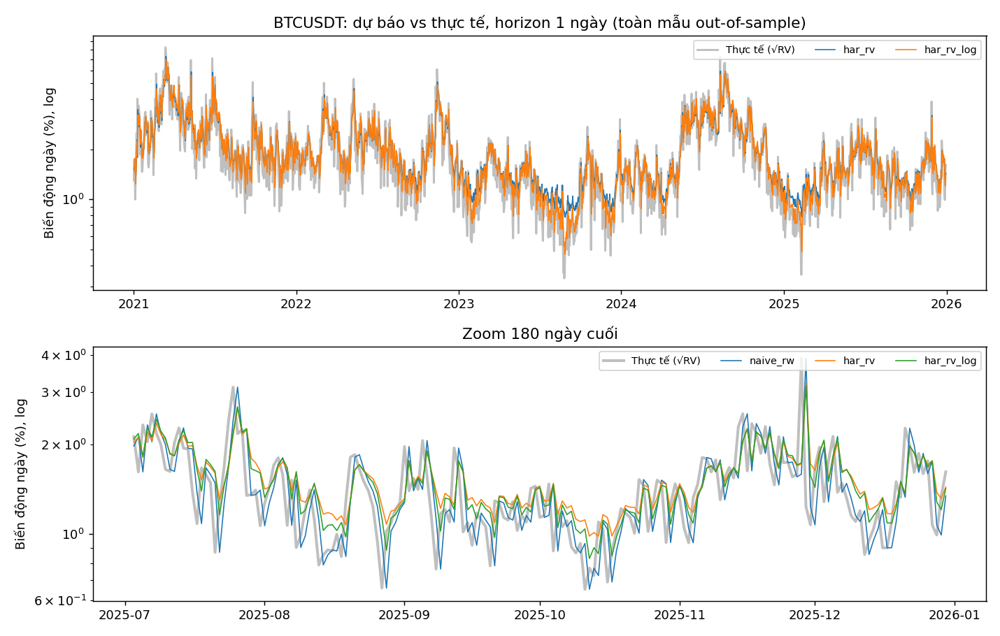
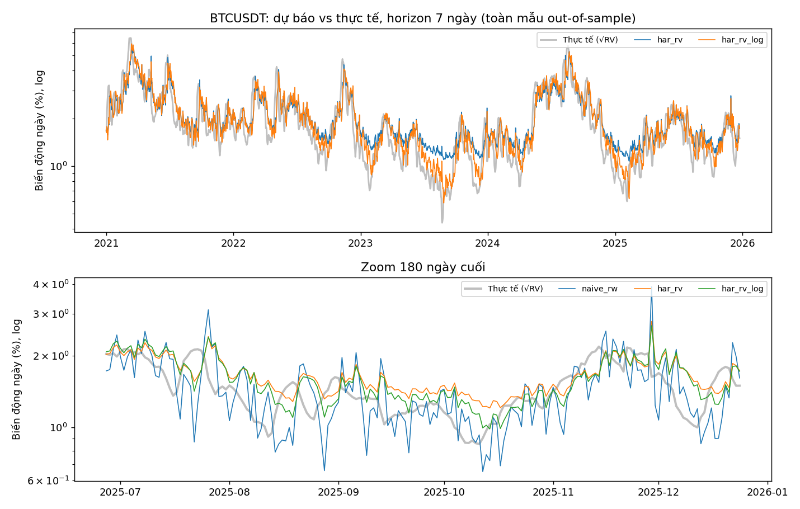
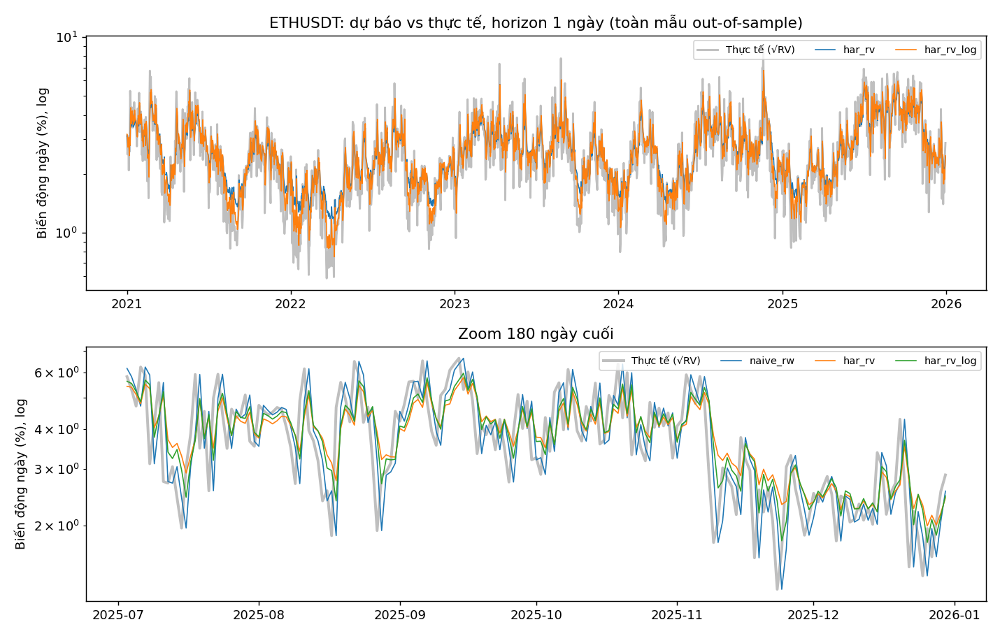
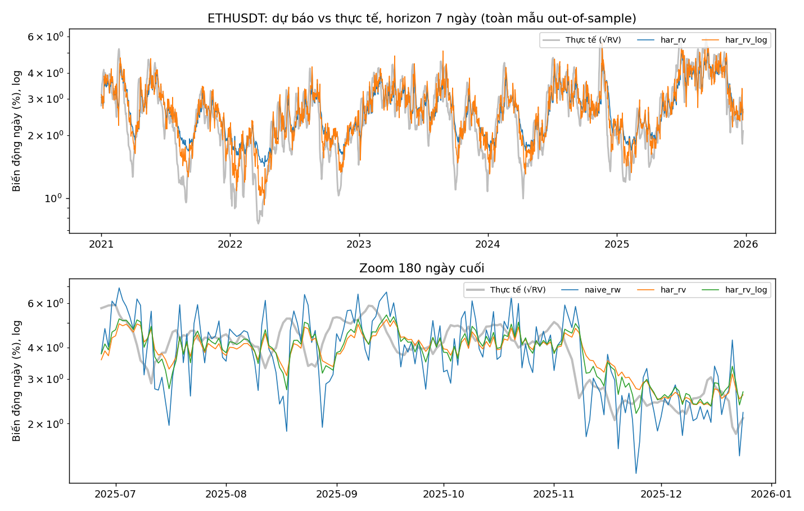
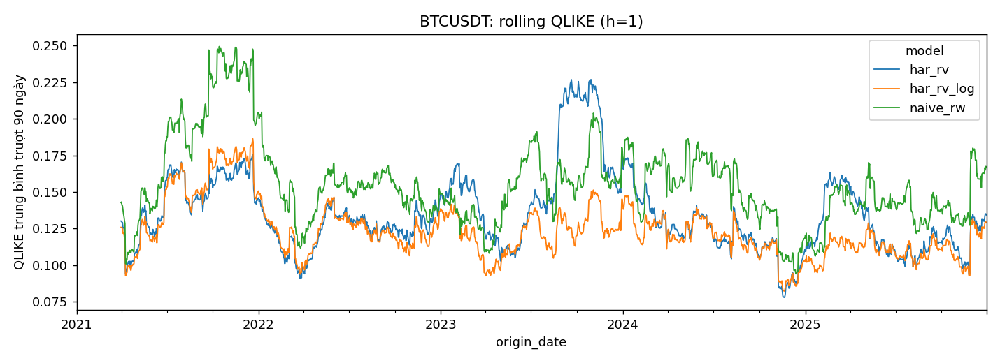
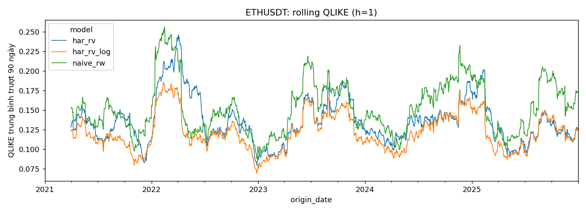
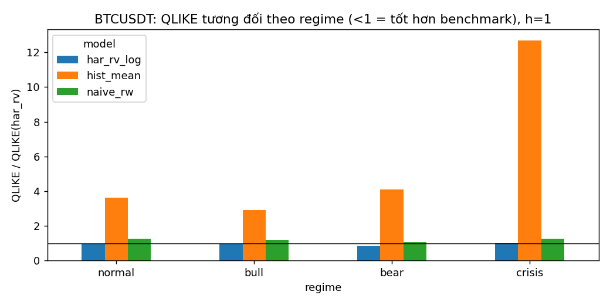
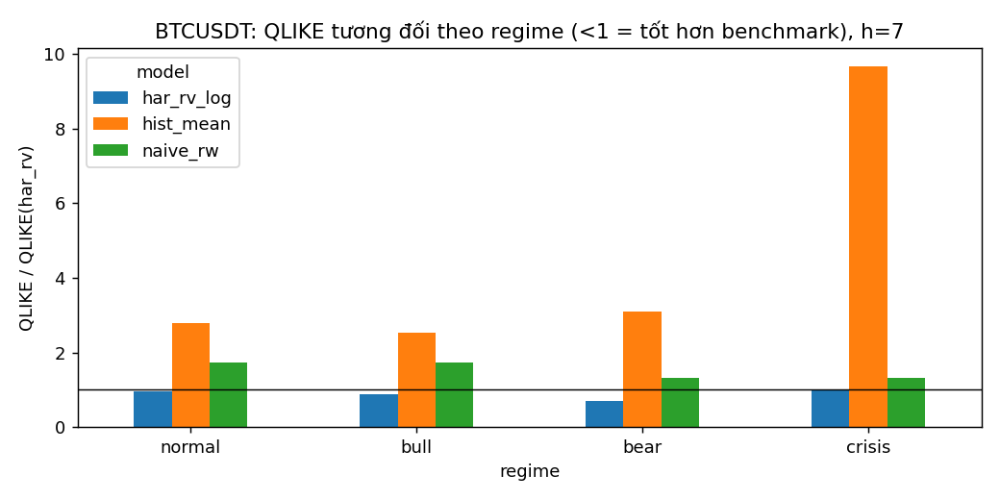
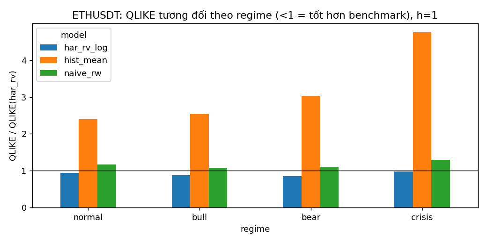
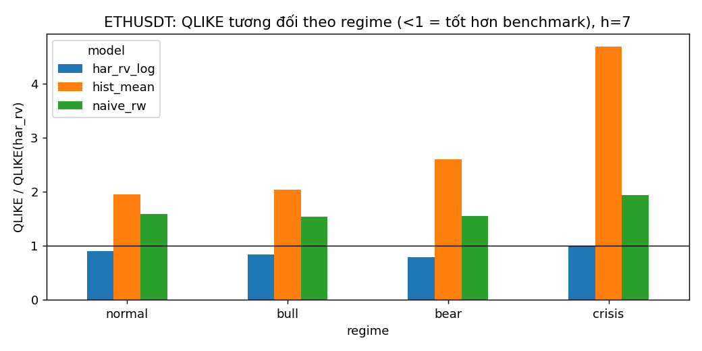

# Chương 5. Kết quả dự báo biến động thực hiện (Realized Volatility)

> **CẢNH BÁO – KẾT QUẢ TRÊN DỮ LIỆU MÔ PHỎNG (`data_source = synthetic`).** Mọi con số/hình dưới đây chỉ kiểm tra pipeline, KHÔNG phản ánh thị trường BTC/ETH thật. Chạy lại toàn bộ pipeline trên dữ liệu Binance rồi sinh lại chương này (`make report`) trước khi nộp.

## 5.1. Thiết lập đánh giá

**Dữ liệu và biến mục tiêu.** Dữ liệu BTCUSDT, ETHUSDT tần suất 5 phút (UTC), nguồn: `synthetic`, giai đoạn
2019-01-01 – 2025-12-31. Return 5 phút là log return nhân 100; realized variance ngày
$RV_t=\sum_j r_{t,j}^2$ trên 288 khoảng/ngày (ngày có dưới 90%
return hợp lệ bị loại, không backfill). Biến mục tiêu ở horizon $h$ là trung bình $RV_{t+1},\dots,RV_{t+h}$
(h = 1, 7 ngày); ML dùng log của biến này.

**Biến đầu vào chung (point-in-time).** $RV_t$, trung bình RV 5 và 22 ngày,
phương sai Parkinson, log return, log turnover (quote volume), VIX và chỉ số USD trễ 1 ngày.
Tính đúng đắn point-in-time được kiểm chứng bằng `tests/test_leakage.py` (phá hỏng toàn bộ dữ liệu sau ngày T không làm đổi feature/dự báo tại các ngày ≤ T).

**Quy trình out-of-sample.** Cửa sổ **expanding**, tối thiểu 365 quan sát huấn luyện, refit mỗi 5 ngày,
mẫu kiểm tra từ 2021-01-01. Tại origin $t$ chỉ huấn luyện trên các quan sát $t' \le t-h$ (nhãn $h$ bước chỉ biết sau $t'+h$).
Mọi mô hình được so sánh trên **cùng tập origin**.

**Thước đo.** RMSE, MAE và QLIKE $=\frac{y}{\hat y}-\ln\frac{y}{\hat y}-1$ (trên RV level; QLIKE là thước đo chính vì bền với nhiễu
trong proxy RV, Patton 2011). So sánh dự báo bằng kiểm định Diebold–Mariano với hiệu chỉnh Harvey–Leybourne–Newbold; phương sai dài hạn dùng
autocovariance tới lag $h-1$ do dự báo $h$ bước chồng lấn. Benchmark: **har_rv**. Khung được kiểm tra bằng mô hình naive
($\hat{RV}_{t+h}=RV_t$), hist-mean và oracle (loss = 0).

## 5.2. Độ chính xác dự báo (RQ1)

| asset   |   horizon | model      |   RMSE |   MAE |   QLIKE |   RMSE/har_rv |   MAE/har_rv |   QLIKE/har_rv |    n |
|:--------|----------:|:-----------|-------:|------:|--------:|--------------:|-------------:|---------------:|-----:|
| BTCUSDT |         1 | har_rv     |  3.563 | 1.788 |   0.135 |         1.000 |        1.000 |          1.000 | 1825 |
| BTCUSDT |         1 | har_rv_log |  3.537 | 1.773 |   0.124 |         0.993 |        0.991 |          0.919 | 1825 |
| BTCUSDT |         1 | hist_mean  |  6.086 | 3.968 |   0.563 |         1.708 |        2.219 |          4.165 | 1825 |
| BTCUSDT |         1 | naive_rw   |  3.927 | 1.901 |   0.156 |         1.102 |        1.063 |          1.154 | 1825 |
| BTCUSDT |         7 | har_rv     |  3.228 | 1.864 |   0.144 |         1.000 |        1.000 |          1.000 | 1819 |
| BTCUSDT |         7 | har_rv_log |  3.171 | 1.782 |   0.121 |         0.982 |        0.956 |          0.841 | 1819 |
| BTCUSDT |         7 | hist_mean  |  5.269 | 3.701 |   0.473 |         1.632 |        1.986 |          3.280 | 1819 |
| BTCUSDT |         7 | naive_rw   |  4.030 | 2.097 |   0.221 |         1.248 |        1.125 |          1.534 | 1819 |
| ETHUSDT |         1 | har_rv     |  5.287 | 3.142 |   0.135 |         1.000 |        1.000 |          1.000 | 1825 |
| ETHUSDT |         1 | har_rv_log |  5.237 | 3.094 |   0.121 |         0.991 |        0.985 |          0.899 | 1825 |
| ETHUSDT |         1 | hist_mean  |  7.687 | 5.213 |   0.395 |         1.454 |        1.659 |          2.925 | 1825 |
| ETHUSDT |         1 | naive_rw   |  5.987 | 3.428 |   0.153 |         1.133 |        1.091 |          1.134 | 1825 |
| ETHUSDT |         7 | har_rv     |  4.161 | 2.856 |   0.123 |         1.000 |        1.000 |          1.000 | 1819 |
| ETHUSDT |         7 | har_rv_log |  4.118 | 2.749 |   0.105 |         0.990 |        0.963 |          0.857 | 1819 |
| ETHUSDT |         7 | hist_mean  |  6.164 | 4.644 |   0.305 |         1.481 |        1.626 |          2.487 | 1819 |
| ETHUSDT |         7 | naive_rw   |  5.970 | 3.555 |   0.197 |         1.435 |        1.245 |          1.603 | 1819 |

*Giá trị `/har_rv` < 1 nghĩa là tốt hơn benchmark.*

- **BTCUSDT, h=1**: QLIKE thấp nhất là `har_rv_log` (0.1242, bằng 0.92× har_rv); RMSE thấp nhất là `har_rv_log` (3.537, bằng 0.993× har_rv).
- **BTCUSDT, h=7**: QLIKE thấp nhất là `har_rv_log` (0.1213, bằng 0.84× har_rv); RMSE thấp nhất là `har_rv_log` (3.171, bằng 0.982× har_rv).
- **ETHUSDT, h=1**: QLIKE thấp nhất là `har_rv_log` (0.1214, bằng 0.90× har_rv); RMSE thấp nhất là `har_rv_log` (5.237, bằng 0.991× har_rv).
- **ETHUSDT, h=7**: QLIKE thấp nhất là `har_rv_log` (0.1053, bằng 0.86× har_rv); RMSE thấp nhất là `har_rv_log` (4.118, bằng 0.990× har_rv).

### Kiểm định Diebold–Mariano so với har_rv

| asset   |   horizon | model      | DM(QLIKE)   | DM(SE)   |    n |
|:--------|----------:|:-----------|:------------|:---------|-----:|
| BTCUSDT |         1 | har_rv_log | -6.04***    | -1.20    | 1825 |
| BTCUSDT |         1 | hist_mean  | 26.47***    | 8.11***  | 1825 |
| BTCUSDT |         1 | naive_rw   | 4.07***     | 3.14***  | 1825 |
| BTCUSDT |         7 | har_rv_log | -3.22***    | -0.92    | 1819 |
| BTCUSDT |         7 | hist_mean  | 7.92***     | 3.25***  | 1819 |
| BTCUSDT |         7 | naive_rw   | 5.30***     | 3.31***  | 1819 |
| ETHUSDT |         1 | har_rv_log | -7.28***    | -1.87*   | 1825 |
| ETHUSDT |         1 | hist_mean  | 24.04***    | 11.76*** | 1825 |
| ETHUSDT |         1 | naive_rw   | 3.39***     | 3.63***  | 1825 |
| ETHUSDT |         7 | har_rv_log | -3.59***    | -0.75    | 1819 |
| ETHUSDT |         7 | hist_mean  | 8.16***     | 5.26***  | 1819 |
| ETHUSDT |         7 | naive_rw   | 5.62***     | 5.41***  | 1819 |

*DM < 0: mô hình có loss thấp hơn har_rv; DM > 0: kém hơn. Dấu * / ** / ***: p < 0,10 / 0,05 / 0,01 (hai phía, t(n−1), HLN).*

### Dự báo so với thực tế

*Hình: BTCUSDT, dự báo vs thực tế, h=1.*

*Hình: BTCUSDT, dự báo vs thực tế, h=7.*

*Hình: ETHUSDT, dự báo vs thực tế, h=1.*

*Hình: ETHUSDT, dự báo vs thực tế, h=7.*

### QLIKE trượt theo thời gian

[TODO-NHÓM] Nhận xét: mô hình ML/DL (khi có) cải thiện so với HAR-RV ở những giai đoạn nào; lợi thế có bền qua thời gian không (rolling QLIKE)?

## 5.3. Phân tích theo regime (RQ3)

**Định nghĩa regime** (point-in-time, tại cuối ngày $t$; tham số trong `config/config.yaml`):
*crisis* nếu RV trung bình 22 ngày vượt phân vị 90% expanding của chính nó (cần ≥ 365 ngày lịch sử);
nếu không, *bear* khi return log 90 ngày ≤ -10%, *bull* khi ≥ +10%, còn lại *normal*.
Ưu tiên crisis > bear > bull > normal. Dự báo được xếp vào regime của **origin**, không phải của ngày được dự báo.

Số ngày kiểm tra theo regime:

| asset   |   horizon |   bear |   bull |   crisis |   normal |
|:--------|----------:|-------:|-------:|---------:|---------:|
| BTCUSDT |         1 |    702 |    358 |      150 |      615 |
| BTCUSDT |         7 |    702 |    352 |      150 |      615 |
| ETHUSDT |         1 |    557 |    587 |      251 |      430 |
| ETHUSDT |         7 |    557 |    584 |      251 |      427 |

| asset   |   horizon | regime   | model      |   n |   QLIKE |   QLIKE/har_rv | DM(QLIKE)   |
|:--------|----------:|:---------|:-----------|----:|--------:|---------------:|:------------|
| BTCUSDT |         1 | bear     | har_rv_log | 702 |   0.121 |          0.854 | -5.61***    |
| BTCUSDT |         1 | bear     | hist_mean  | 702 |   0.583 |          4.112 | 22.38***    |
| BTCUSDT |         1 | bear     | naive_rw   | 702 |   0.149 |          1.047 | 0.80        |
| BTCUSDT |         1 | bull     | har_rv_log | 358 |   0.139 |          0.938 | -2.64***    |
| BTCUSDT |         1 | bull     | hist_mean  | 358 |   0.431 |          2.907 | 10.62***    |
| BTCUSDT |         1 | bull     | naive_rw   | 358 |   0.176 |          1.187 | 2.29**      |
| BTCUSDT |         1 | crisis   | har_rv_log | 150 |   0.092 |          1.024 | 1.04        |
| BTCUSDT |         1 | crisis   | hist_mean  | 150 |   1.139 |         12.676 | 7.71***     |
| BTCUSDT |         1 | crisis   | naive_rw   | 150 |   0.113 |          1.253 | 2.39**      |
| BTCUSDT |         1 | normal   | har_rv_log | 615 |   0.127 |          0.970 | -1.57       |
| BTCUSDT |         1 | normal   | hist_mean  | 615 |   0.475 |          3.635 | 20.91***    |
| BTCUSDT |         1 | normal   | naive_rw   | 615 |   0.163 |          1.248 | 3.55***     |
| BTCUSDT |         7 | bear     | har_rv_log | 702 |   0.117 |          0.713 | -3.25***    |
| BTCUSDT |         7 | bear     | hist_mean  | 702 |   0.508 |          3.097 | 7.36***     |
| BTCUSDT |         7 | bear     | naive_rw   | 702 |   0.218 |          1.327 | 2.04**      |
| BTCUSDT |         7 | bull     | har_rv_log | 352 |   0.119 |          0.892 | -1.19       |
| BTCUSDT |         7 | bull     | hist_mean  | 352 |   0.335 |          2.517 | 3.91***     |
| BTCUSDT |         7 | bull     | naive_rw   | 352 |   0.232 |          1.741 | 2.74***     |
| BTCUSDT |         7 | crisis   | har_rv_log | 150 |   0.102 |          0.994 | -0.06       |
| BTCUSDT |         7 | crisis   | hist_mean  | 150 |   0.991 |          9.655 | 2.39**      |
| BTCUSDT |         7 | crisis   | naive_rw   | 150 |   0.135 |          1.313 | 1.29        |
| BTCUSDT |         7 | normal   | har_rv_log | 615 |   0.132 |          0.960 | -0.60       |
| BTCUSDT |         7 | normal   | hist_mean  | 615 |   0.385 |          2.793 | 6.83***     |
| BTCUSDT |         7 | normal   | naive_rw   | 615 |   0.240 |          1.741 | 4.74***     |
| ETHUSDT |         1 | bear     | har_rv_log | 557 |   0.108 |          0.851 | -5.36***    |
| ETHUSDT |         1 | bear     | hist_mean  | 557 |   0.384 |          3.014 | 16.28***    |
| ETHUSDT |         1 | bear     | naive_rw   | 557 |   0.139 |          1.090 | 1.29        |
| ETHUSDT |         1 | bull     | har_rv_log | 587 |   0.116 |          0.875 | -5.92***    |
| ETHUSDT |         1 | bull     | hist_mean  | 587 |   0.337 |          2.534 | 11.52***    |
| ETHUSDT |         1 | bull     | naive_rw   | 587 |   0.143 |          1.079 | 1.26        |
| ETHUSDT |         1 | crisis   | har_rv_log | 251 |   0.126 |          0.984 | -0.51       |
| ETHUSDT |         1 | crisis   | hist_mean  | 251 |   0.608 |          4.753 | 10.24***    |
| ETHUSDT |         1 | crisis   | naive_rw   | 251 |   0.167 |          1.301 | 2.58**      |
| ETHUSDT |         1 | normal   | har_rv_log | 430 |   0.143 |          0.938 | -2.02**     |
| ETHUSDT |         1 | normal   | hist_mean  | 430 |   0.364 |          2.395 | 12.71***    |
| ETHUSDT |         1 | normal   | naive_rw   | 430 |   0.177 |          1.167 | 1.90*       |
| ETHUSDT |         7 | bear     | har_rv_log | 557 |   0.094 |          0.786 | -2.33**     |
| ETHUSDT |         7 | bear     | hist_mean  | 557 |   0.310 |          2.598 | 5.15***     |
| ETHUSDT |         7 | bear     | naive_rw   | 557 |   0.185 |          1.550 | 2.75***     |
| ETHUSDT |         7 | bull     | har_rv_log | 584 |   0.100 |          0.838 | -2.75***    |
| ETHUSDT |         7 | bull     | hist_mean  | 584 |   0.243 |          2.038 | 4.41***     |
| ETHUSDT |         7 | bull     | naive_rw   | 584 |   0.183 |          1.539 | 3.45***     |
| ETHUSDT |         7 | crisis   | har_rv_log | 251 |   0.102 |          0.991 | -0.10       |
| ETHUSDT |         7 | crisis   | hist_mean  | 251 |   0.480 |          4.684 | 4.37***     |
| ETHUSDT |         7 | crisis   | naive_rw   | 251 |   0.199 |          1.940 | 2.53**      |
| ETHUSDT |         7 | normal   | har_rv_log | 427 |   0.130 |          0.901 | -1.82*      |
| ETHUSDT |         7 | normal   | hist_mean  | 427 |   0.282 |          1.958 | 4.54***     |
| ETHUSDT |         7 | normal   | naive_rw   | 427 |   0.229 |          1.591 | 2.78***     |

*Chỉ báo DM khi regime có ≥ 30 ngày; regime ít quan sát cần đọc thận trọng, và các quan sát trong cùng regime tự tương quan mạnh nên p-value có xu hướng quá lạc quan.*

[TODO-NHÓM] Diễn giải kinh tế: vì sao lợi thế/bất lợi của từng mô hình thay đổi giữa các regime (đặc biệt crisis)?

## 5.4. Hạn chế và kiểm tra độ vững

- Proxy RV từ 5 phút chịu nhiễu vi cấu trúc; nên kiểm tra thêm với 15 phút / RV-subsampled.
- Regime là định nghĩa ngưỡng cứng; nên thử ngưỡng khác (sensitivity).
- Dự báo nhiều bước dùng biến mục tiêu trung bình chồng lấn; DM đã hiệu chỉnh nhưng mẫu hiệu dụng nhỏ hơn n.
- Kết quả đo độ chính xác thống kê; ý nghĩa kinh tế (RQ5) và VaR/ES (RQ4) nằm ở các chương sau.
